# SuperCommander manual

SuperCommander is a dual-pane file manager for local and remote files. It
comes as:

- **`sc-gui`**, a desktop window (Qt 6), shipped as an AppImage on Linux;
- **`sc`**, one program that is the terminal interface, a command line for
  scripts, and the agent that runs on servers.

Both interfaces work the same way and share every shortcut, so what you learn
in one works in the other. There are no toolbars or icons: every command is
in the command list (**F9**), where you find it by typing or by category,
and on the keyboard. **F1 shows the main shortcuts** at any time.

The pictures in this manual come from `scripts/screenshots.sh`, which drives
the real window on a demo folder.

## Contents

1. [Getting started](#getting-started)
2. [Commands (F9)](#commands-f9)
3. [The panels](#the-panels)
4. [Working with files](#working-with-files)
5. [Selecting files](#selecting-files)
6. [The viewer](#the-viewer)
7. [Quick view](#quick-view)
8. [Searching and comparing](#searching-and-comparing)
9. [Archives](#archives)
10. [Remote locations](#remote-locations)
11. [Servers: the agent and `sc serve`](#servers-the-agent-and-sc-serve)
12. [The transfer queue](#the-transfer-queue)
13. [Bookmarks, tabs and history](#bookmarks-tabs-and-history)
14. [Plugins and scripts](#plugins-and-scripts)
15. [The command line](#the-command-line)
16. [Settings](#settings)
17. [All shortcuts](#all-shortcuts)

## Getting started

Start the window with `sc-gui` (or the AppImage), or the terminal interface
with `sc`. Both take up to two locations, one for each panel:

```sh
sc-gui ~/Projects sftp://nas/backup
sc ~/Downloads s3://photos/2026
```

Without locations both panels open the current folder. The window also
takes `--size=WIDTHxHEIGHT` to choose its starting size.

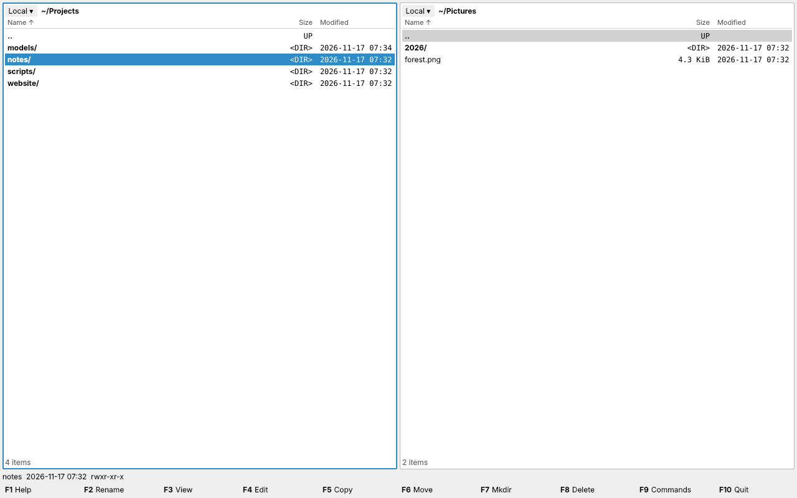

The window adapts to its size; here it is at 800 × 500 and at 1920 × 1080:

| 800 × 500 | 1920 × 1080 |
|---|---|
|  | 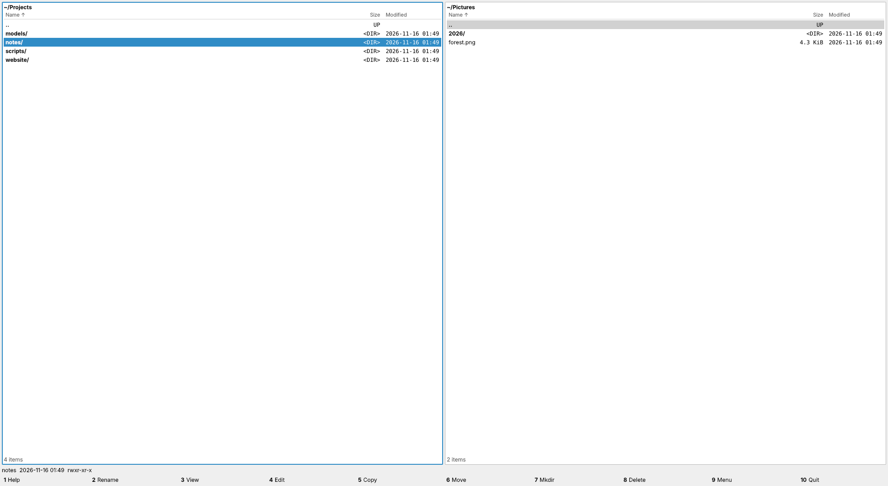 |

## Commands (F9)

**F9** opens the command list: every command of SuperCommander, of your
plugins and of your scripts, one per row as `Category/Command`, with its
shortcuts on the right.

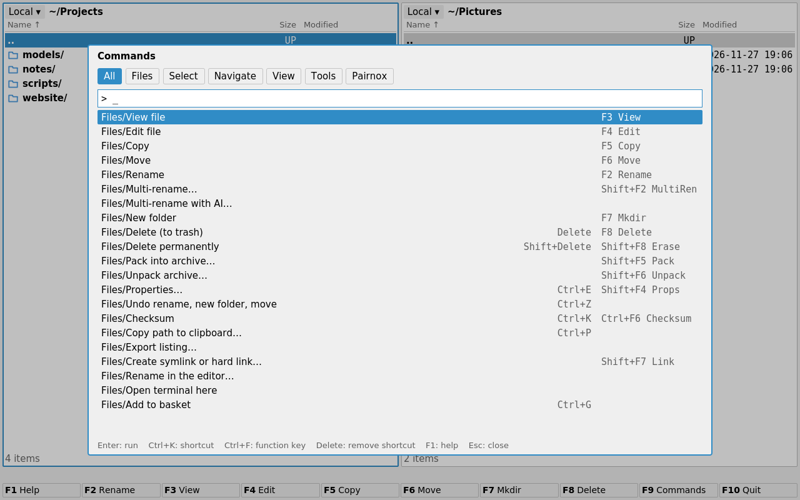

- **Type** to find a command: the list keeps the rows that contain every
  word you typed, in the command or in its category (`files check` finds
  Files/Checksum), the names starting with what you typed first.
  Backspace erases a letter, Ctrl+U or Esc empties the filter.
- **Categories**: the buttons on top (All, Files, Select, Navigate, View,
  Tools, SuperCommander, and Plugins and Scripts when you have some) show
  one category only. Left and Right (or Tab) move between them; in the
  window you can also click them.
- **Up/Down**, Page Up/Down, Home/End move; **Enter** (or a click in the
  window) runs the command.
- **Ctrl+K** gives the highlighted command a shortcut: press the new key
  (Esc cancels). If another command had that key, it loses it and the status
  line says which one. **Delete** removes the command's shortcuts. The
  change is saved at once, as on the settings screen.
- **Esc** empties the filter, or closes the list.


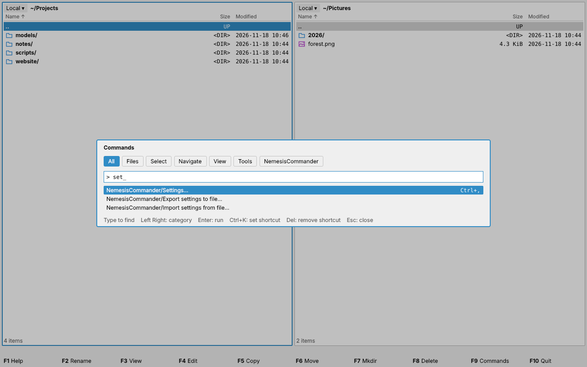

In the window the menu bar has the same commands, one menu per category.

## The panels

Each panel lists one folder: name, size and modification date. The title of
the panel shows the location (your home folder is written `~`); the column
titles show the sort order with an arrow. Folders are bold and end in `/`;
`..` goes up.

- **Tab** switches between the panels. The active panel has a coloured
  border and a strong cursor bar; the other keeps a faint one.
- **Enter** opens a folder (or an archive), **Backspace** goes to the parent.
- **Ctrl+L** goes to any location: a path, `~/…`, or a URI such as
  `sftp://host/dir`.
- **Ctrl+F3 / Ctrl+F4 / Ctrl+F6 / Ctrl+F5** sort by name, extension, size or
  date; pressing the same one again reverses the order.
- **Ctrl+H** shows or hides hidden files, **Ctrl+R** reloads.
- **Ctrl+S** filters the listing as you type (`*.pdf`, `report`).
- **Ctrl+U** swaps the panels, **Alt+O** opens this folder in the other one.

The line under the panels describes the entry under the cursor (size, date,
permissions, link target) or shows the last message. The bottom row lists
what F1–F10 do.

## Working with files

Commands act on the selected entries, or on the entry under the cursor when
nothing is selected. Copy and move go to the folder of the other panel by
default; the destination can be edited before you confirm.

| Key | Command |
|---|---|
| F3 | View the file ([the viewer](#the-viewer)) |
| F4 | Edit the file in your editor |
| F5 | Copy |
| F6 | Move |
| Shift+F6 or F2 | Rename |
| Ctrl+M | Rename many files with a template |
| F7 | New folder |
| F8 or Delete | Delete (to the recycle bin when there is one) |
| Shift+F8 | Delete permanently |
| Alt+F5 / Alt+F9 | Pack into an archive / unpack one |
| Alt+Enter | Properties, and change the permissions |
| Ctrl+K | Checksum (BLAKE3, XXH3 or SHA-256) |

| Copy | New folder | Delete |
|---|---|---|
|  |  | 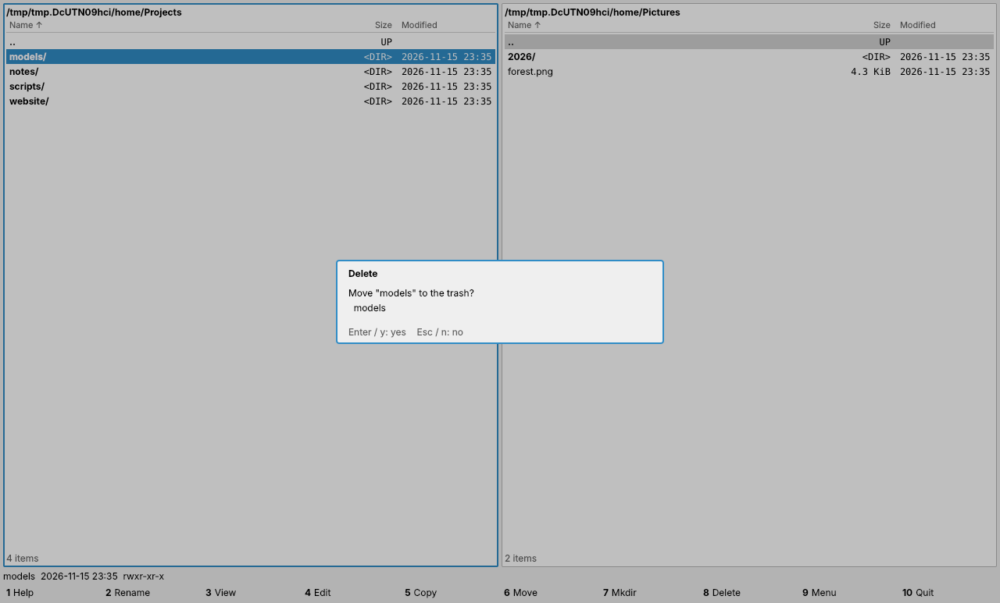 |

When a file already exists at the destination, SuperCommander asks whether
to overwrite, skip, keep both (renaming the new one) or overwrite only if
newer, for this file or for all of them. Every copy and move becomes a job
in the [transfer queue](#the-transfer-queue), so you can keep working while
it runs.

Properties show the name, location, type, size, date and permissions; on
systems with Unix permissions, Enter changes them (octal mode).

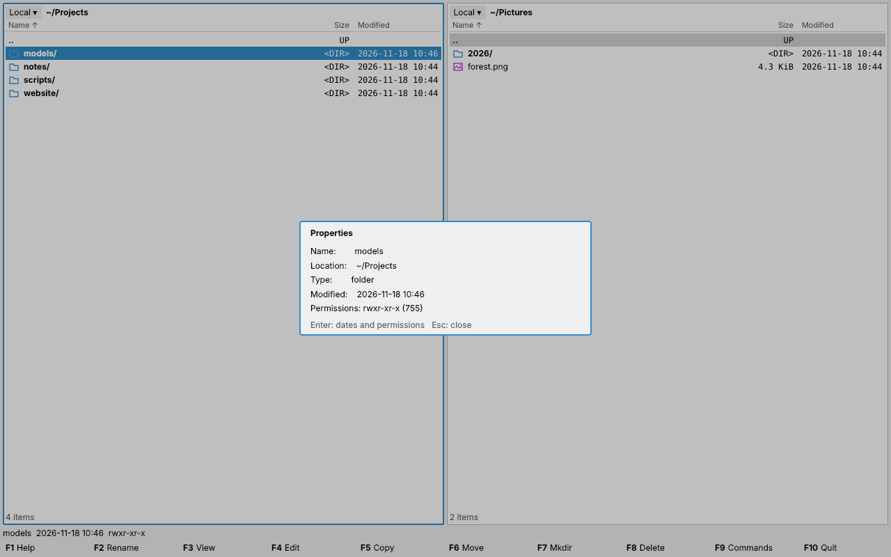

## Selecting files

- **Insert** or **Space** selects the entry under the cursor and moves down.
- **+** selects by mask (`*.jpg;*.png`), **-** unselects by mask,
  **\*** inverts the selection, **Ctrl+A** selects everything.

Selected entries are tinted, bold and marked at the left edge, so they stay
visible under the cursor. The panel footer counts the selected files,
folders and bytes.

## The viewer

F3 opens the viewer on the file under the cursor. It recognises the kind of
file and shows it the best way it can; **F4** always switches to the raw
bytes (hex) and back. The header lists the keys of the current kind of file
and the footer gives details (pages, picture size, zoom). **Esc** closes.

**Text** is shown with tabs expanded; F2 wraps long lines. Files that are not
text open as hex. Very large files are read only in part.

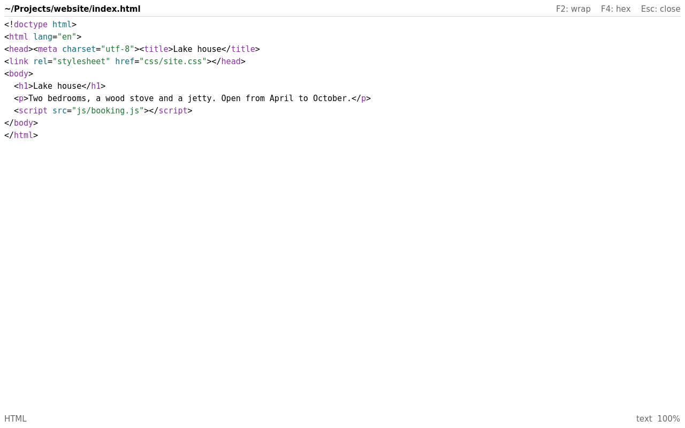

**Markdown** is shown formatted: headings, emphasis, lists, quotes, code
blocks and tables.


**Office documents** are shown as formatted text: Word (`.docx`) and
OpenDocument text (`.odt`) with headings, bold and italic, lists and tables;
spreadsheets (`.xlsx`, `.xls`, `.ods`) as one table per sheet; presentations
(`.pptx`, `.odp`) as the text of each slide.

| Word | Spreadsheet | Slides |
|---|---|---|
| 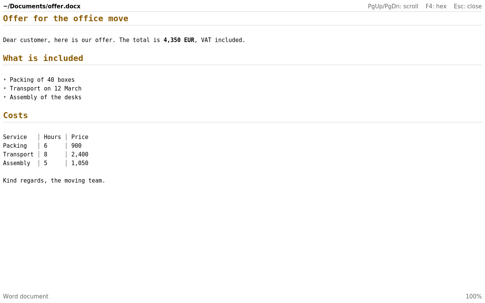 | 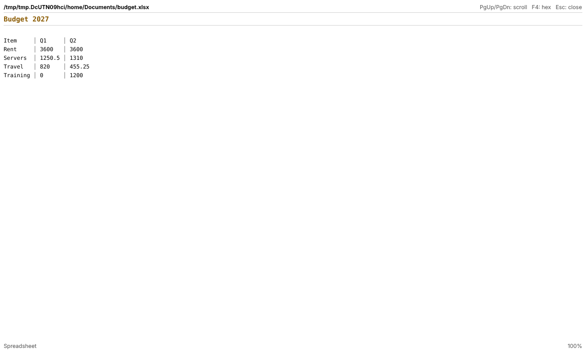 | 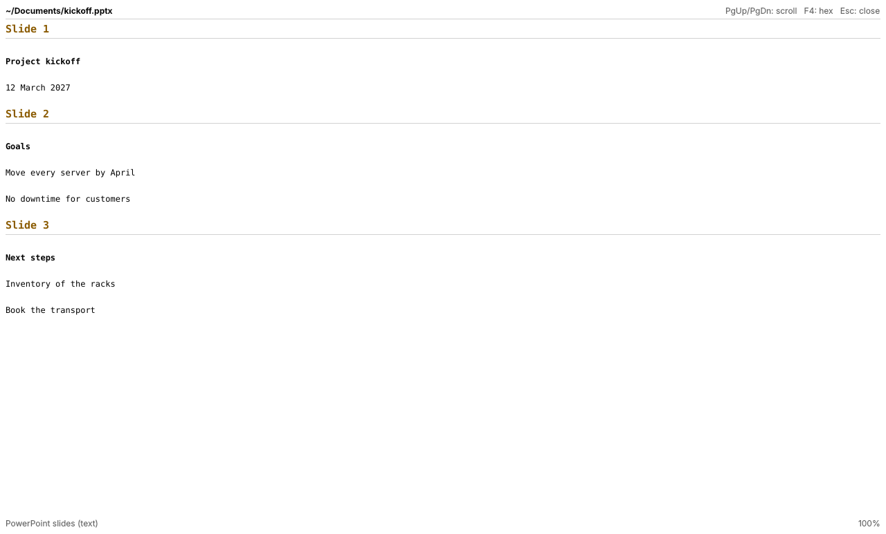 |

**PDF** pages are drawn by a built-in renderer (no external program).
PgDn/Space and PgUp turn the pages, Home and End go to the first and last;
**+**/**-** zoom and the arrows move around a zoomed page; **0** fits the page
again.

| Page 1 | Page 2 |
|---|---|
| 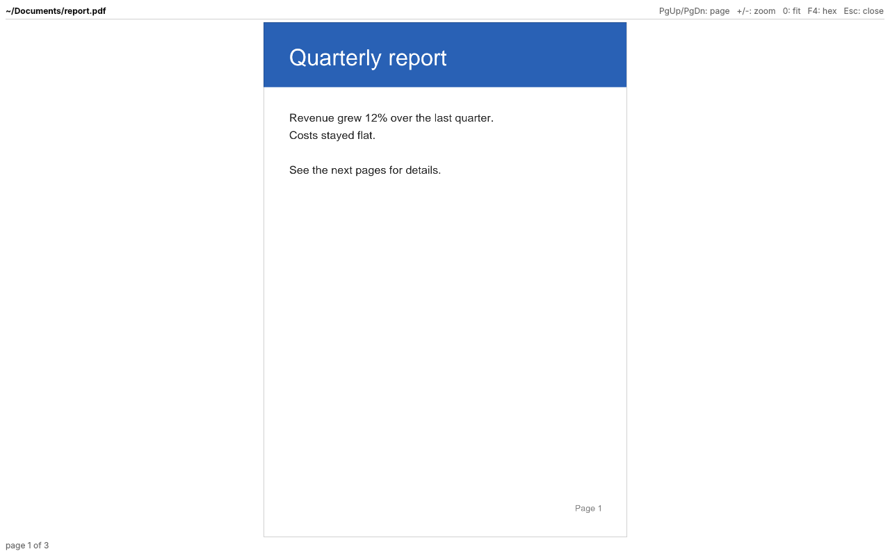 |  |

**3D models** (STL, OBJ, PLY, glTF and GLB) are drawn shaded. The arrows
turn the model, **+**/**-** zoom, **0** goes back to the first view; the footer
shows the number of triangles and the angles.

| Model | Turned and zoomed |
|---|---|
| 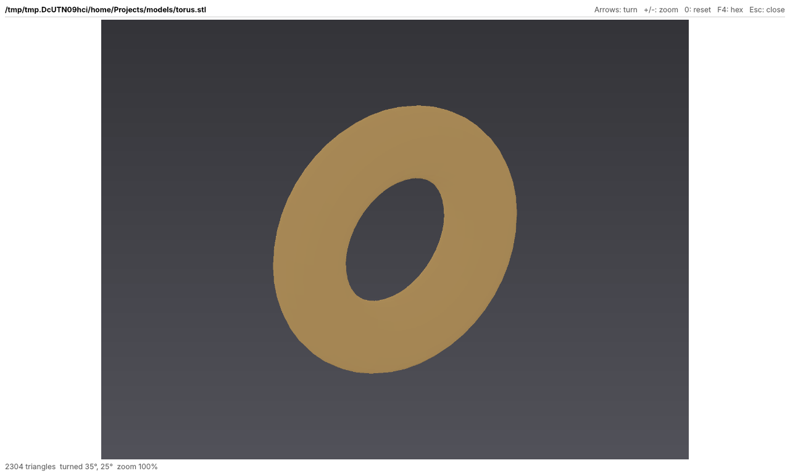 | 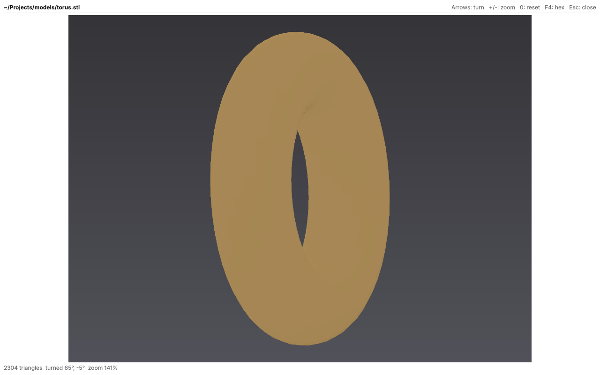 |

**Pictures** (PNG, JPEG, GIF, WebP, BMP, ICO, TIFF) fit the window; **+**
and **-** zoom by steps up to 16×, the arrows move around, **0** fits again.

| Fit | Zoomed |
|---|---|
| 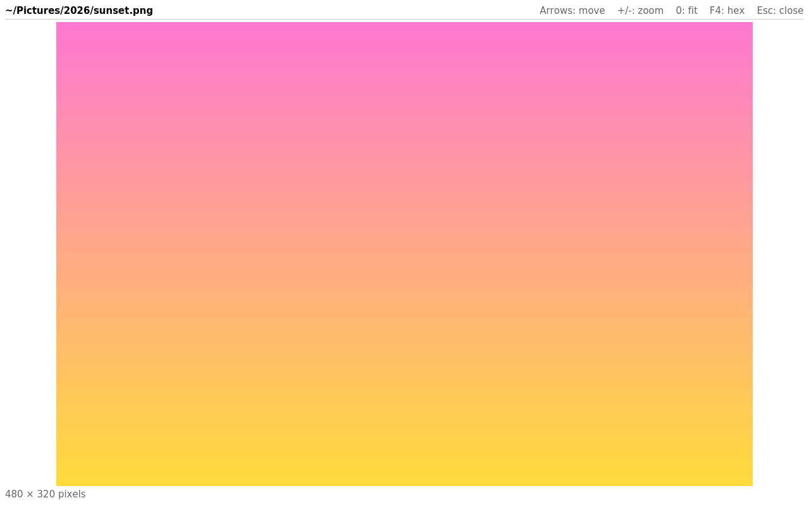 | 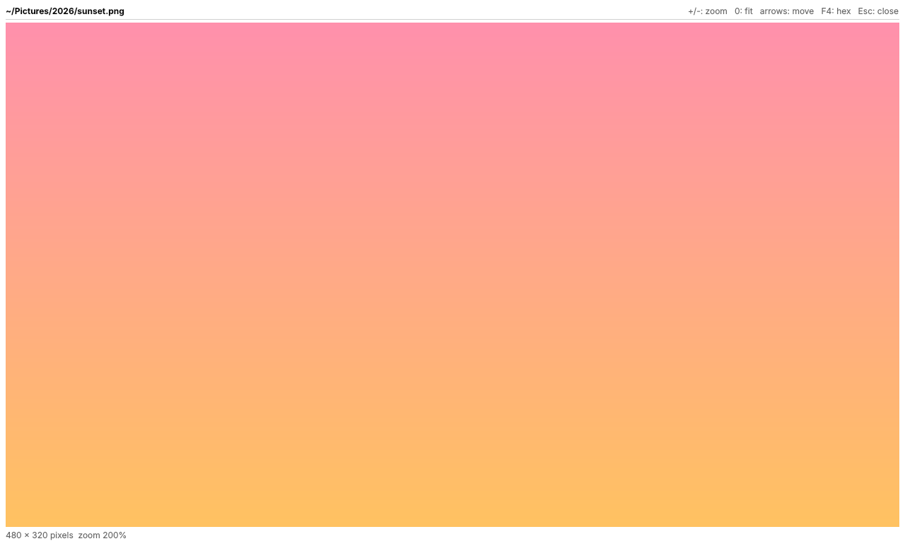 |

The terminal interface shows the same things: formatted documents in
colour, and pages, models and pictures with coloured half-block characters.

The viewer works on every location, remote ones and archives included.

## Quick view

**Ctrl+Q** turns the other panel into a preview of the entry under the
cursor, and keeps following the cursor as you move. It shows everything the
viewer shows; Ctrl+Q again closes it.

| PDF | Model | Markdown |
|---|---|---|
| 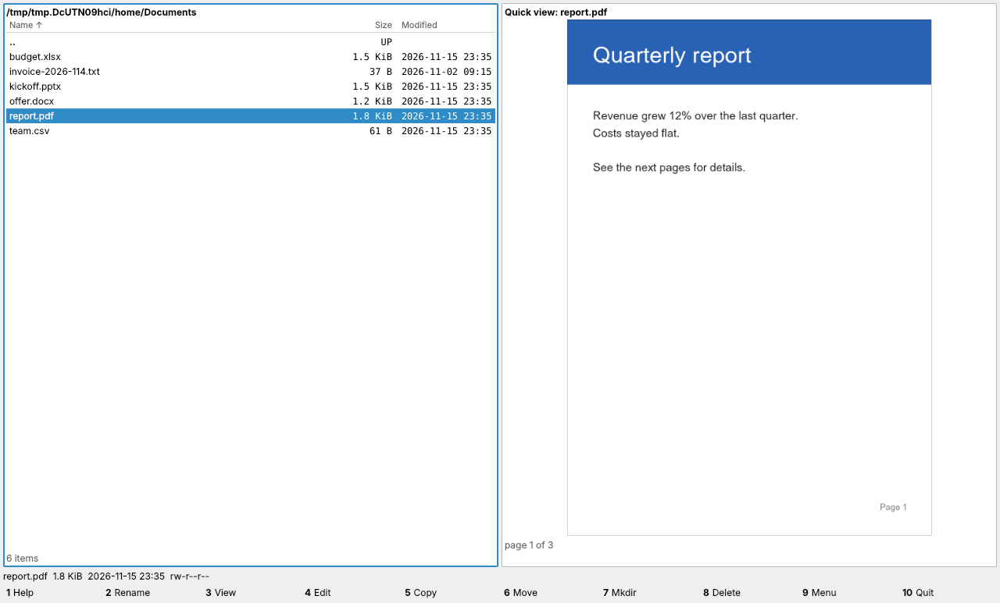 | 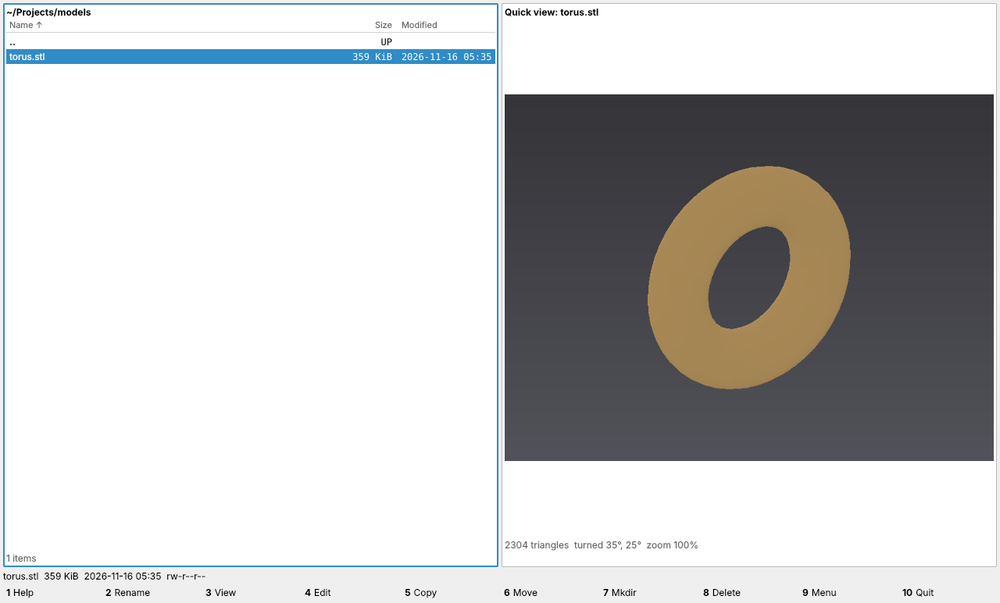 |  |

## Searching and comparing

**Alt+F7** searches below the current folder by name mask (`*.rs;*.toml`,
with `!` to exclude) and, optionally, by text the files contain. Results
appear in a list as they are found; Enter jumps to the chosen file in the
panel. On the command line, `sc find` also searches by regular expression,
size and age.


**Alt+C** compares: two files (one under the cursor in each panel) by
content, or two folders, selecting the entries that differ.

## Archives

Archives open like folders: press Enter on one, browse it, view and copy
files out of it. Supported: ZIP, 7-Zip, tar (plain, gz, bz2, xz, zst),
single compressed files (`.gz`, `.xz`, …) and RAR (reading only). Alt+F5
packs the selection into a new archive, choosing the format from the name;
Alt+F9 unpacks.

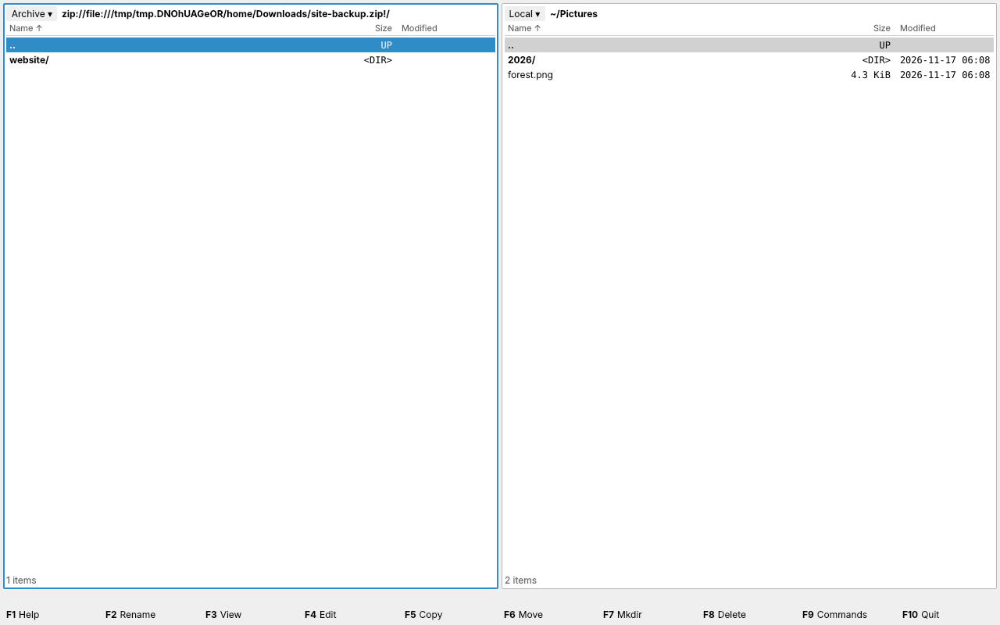

## Remote locations

Every command works the same on remote locations, written as URIs:

| Location | Example |
|---|---|
| SFTP (through your OpenSSH setup and keys) | `sftp://user@host/dir` |
| SMB / Windows shares | `smb://host/share/dir` |
| WebDAV (`dav` or `davs` for HTTPS) | `davs://cloud.example.org/remote.php/dav/files/me` |
| Amazon S3 and compatible services | `s3://bucket/dir` |
| A server running the SuperCommander agent over SSH | `agent://host/dir` |
| A server running `sc serve` | `scs://host:7443/dir` |
| Inside an archive | `zip:///home/me/site.zip!/css` |

### One list for drives and connections

**Alt+F1** (or **Ctrl+N**) opens the drive list: the drives of this computer
and your saved connections together, grouped by a category column:

- **Local**: your home folder, the root and the disks and network shares
  mounted on this computer (drive letters on Windows, `/Volumes` on macOS).
- **Remote**: saved SFTP, SMB, WebDAV, S3, agent and `sc serve` connections.
- **Archive**: a saved location inside an archive file.

Enter opens the highlighted row in the active panel, the same way for every
category: a server then behaves like a local drive, with the same keys,
copy and move between any two panels, the viewer, search and the transfer
queue.


The last row, **New connection…**, asks for a location (for example
`sftp://me@nas/srv`), then for the name to save it under (the host is
suggested), opens it and keeps it in the list. **Delete** removes a saved
connection; the drives of this computer stay. Connections are also kept in
`[[connections]]` in the settings file, so they travel with exported and
shared settings.

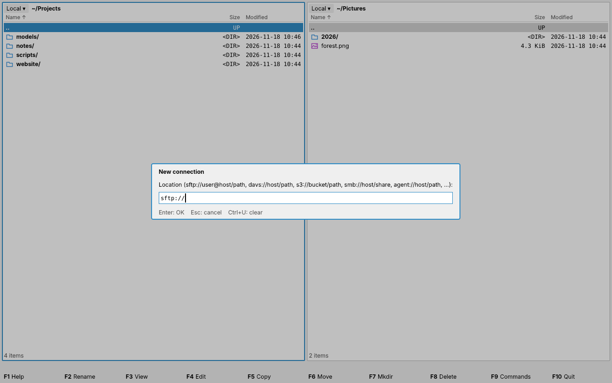

Passwords are never stored in SuperCommander's settings: SFTP and the agent
use SSH (keys, agent, `~/.ssh/config`), WebDAV and SMB read `~/.netrc`, S3
reads the usual `~/.aws` files and environment variables.

## Servers: the agent and `sc serve`

On a Linux server, the `sc` agent (a single static program, no
dependencies) makes remote work much faster than SFTP: listings, searches,
checksums and copies between folders of that server run on the server.

- **Over SSH**, with nothing to set up: copy `sc` to the server and use
  `agent://host/path`. SuperCommander starts `sc agent --stdio` through SSH.
- **Permanently**, with `sc serve`, for long jobs and for copies directly
  between two servers. On your machine, `sc tls init` creates a private
  certificate authority once; `sc tls server NAME --out DIR` issues a bundle
  for each server, which runs `sc serve --tls DIR`. Connections use mutual
  TLS; `--root` limits what is served and `--read-only` refuses changes.

Copies between two `scs://` servers go directly from one to the other when
they can reach each other (each authorised by a one-time token that expires
after five minutes), otherwise through your machine. `sc cp` prints the
route taken; `--route` chooses one.

## The transfer queue

Copies and moves run in the background as jobs. **Ctrl+J** shows the queue:
progress, speed and errors of each job, with keys to pause (`p`), resume or
retry (`r`), cancel (`c`), change priority (`+`/`-`) and clear finished jobs
(`x`). The status line shows how many jobs are running and their progress.

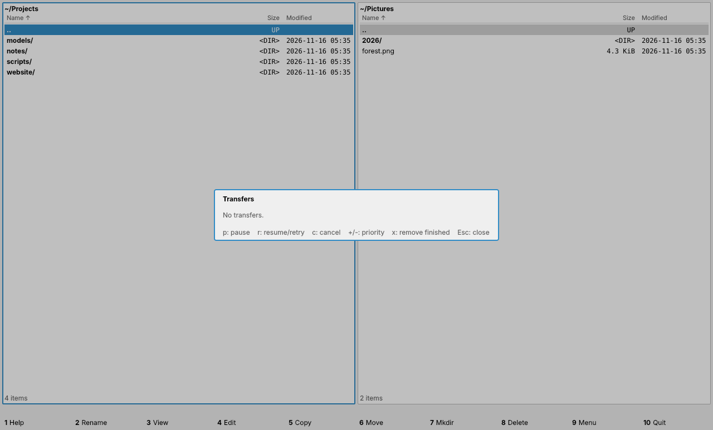

Jobs are written to a journal, so a copy interrupted by a crash or a lost
connection can be resumed. After copying, files are checked (by size by
default, or by a full XXH3 or BLAKE3 hash); settings choose the number of
parallel jobs and files, retries, and a bandwidth limit.

## Bookmarks, tabs and history

- **Ctrl+Shift+D** bookmarks the current folder, **Ctrl+D** lists the
  bookmarks (Enter opens one, Delete removes it).
- **Ctrl+T** opens a tab, **Ctrl+W** closes it, **Ctrl+Tab** and
  **Ctrl+Shift+Tab** move between tabs. Each panel has its own tabs.
- **Alt+Left** and **Alt+Right** go back and forward in the folders visited.


## Plugins and scripts

SuperCommander runs extensions written in TypeScript (or JavaScript) with a
small `sc` API to list, read, write, copy and search files on any location.
Scripts run in a sandbox: they can only touch the paths they were allowed.

- `sc run script.ts` runs a script from the command line, with
  `--allow-read` and `--allow-write` for the paths it may use.
- Plugins are folders with a `plugin.json` that names their commands and the
  permissions they need (for example `$SELECTION` or `$OTHER`). Install one
  with `sc plugin install DIR`; the first run asks you to allow its
  permissions.
- Plugin commands are in the command list (F9) as `Category/Command`: in
  the category their manifest names (`"category": "Files"`), or in
  **Plugins**. Each can have a shortcut (Ctrl+K in the list).
- Your own scripts go in the `scripts` folder of the data folder
  (`~/.local/share/supercommander/scripts` on Linux). Each `.ts` or `.js`
  file there is a command in the **Scripts** category, which can have a
  shortcut too. It runs on the active panel like a script from a panel, with
  no question, since you put it there.
- **Alt+X** in either interface lists the plugin commands, and offers to run
  the script under the cursor, after a confirmation.
- The window has no script engine of its own: it runs scripts and plugins
  with the `sc` program installed next to it (the AppImage has both), so
  they behave exactly as from the command line.

- `sc test SCRIPT_OR_PLUGIN` tries it on sample files in a throwaway
  folder and lists what it printed and which files it created, removed and
  changed, so you (or an AI assistant writing it for you) can check it
  before running it on real files. `sc run --guide` prints a guide for
  AI assistants.
- **Tools/Write a script with AI…** (F9) asks what the script should do;
  Claude writes it with your Anthropic API key, `sc test` checks it, and
  Claude fixes it until it passes. It then appears under **Scripts**. From
  the command line: `sc ai new "description"` (key: `sc ai key` or
  `ANTHROPIC_API_KEY`).

See [docs/scripting.md](../scripting.md) for the API and the examples in
`examples/`.

## The command line

`sc` with a command works without the interface, for scripts and quick
jobs. Every command accepts the same locations as the panels.

| Command | What it does |
|---|---|
| `sc ls LOCATION` | List a folder (`--json` for scripts) |
| `sc cp SRC... DEST` | Copy, with `--conflict`, `--verify`, `--parallel`, `--limit`, `--queue`, `--route` |
| `sc mv SRC... DEST` | Move or rename |
| `sc rm PATH...` | Delete |
| `sc mkdir PATH...` | Create folders |
| `sc cat FILE` | Print a file |
| `sc hash FILE...` | Checksums (`--algorithm blake3`, `xxh3` or `sha256`) |
| `sc find DIR` | Search by `--name`, `--content` (`--regex`), size and age |
| `sc pack` / `sc unpack` | Create and extract archives |
| `sc rename FILE...` | Rename many files with a template (`[N]`, `[E]`, `[C]` counter, find and replace, `--dry-run`) |
| `sc jobs` | Show and control the transfer queue |
| `sc config path / show / export / import` | Locate, print, back up and restore the settings |
| `sc config push LOCATION...` / `pull LOCATION` | Send settings to other machines, or fetch theirs |
| `sc keys` | Print the main shortcuts |
| `sc run` / `sc plugin` | Scripts and plugins |
| `sc agent --stdio`, `sc serve`, `sc tls` | The server side (Linux) |

For example:

```sh
sc cp --verify full ~/Pictures/2026 sftp://nas/backup/pictures/
sc find ~/Projects --name "*.rs" --content "TODO" --json
sc rename --template "holiday-[C].[E]" --digits 3 *.jpg --dry-run
```

## Settings

**Ctrl+,** opens the settings screen. It lists every option, every
command's shortcuts, and the commands to share settings. Changes are saved
and applied at once; values that differ from the built-in ones are marked
with a dot.

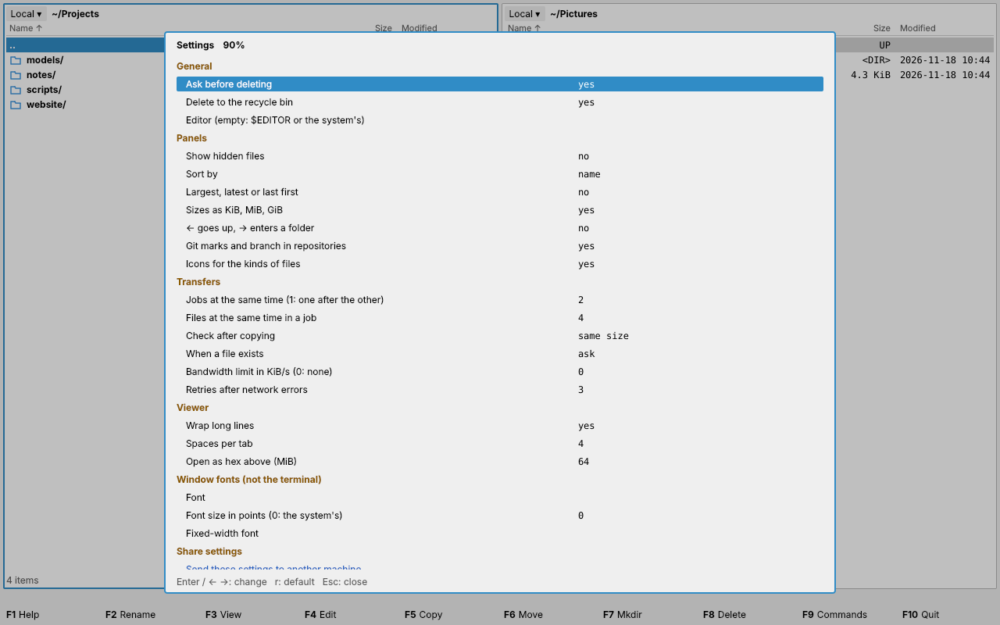

- **Options**: Enter or ← → change on/off and choice options; numbers and
  text are typed after Enter (← → also step numbers). **r** puts the
  default back.
  - General: confirm before deleting, use the recycle bin, the editor.
  - Panels: hidden files, sort order, human-readable sizes.
  - Transfers: jobs at the same time (1 runs them one after the other, in
    priority order), files at the same time in a job, the check after
    copying, what to do when a file exists, the bandwidth limit, retries.
  - Viewer: wrapping, tab width, when to open files as hex.
- **Shortcuts**: Enter, then press the new key. **a** adds a key instead
  of replacing them, **Delete** leaves the command without a key, **r**
  gives back the built-in keys. A key that belonged to another command is
  taken from it, and the status line says which.

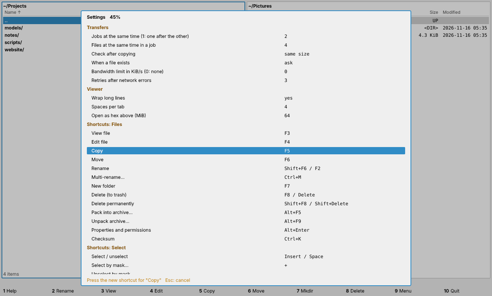

The same settings serve the window and the terminal interface: a shortcut
changed in one works in the other.

### Sharing settings with other machines

The last rows of the screen, and `sc config`, move settings between
machines. Nothing is synchronized in the background: settings move only
when you send or fetch them.

- **Send these settings to another machine…** (`sc config push LOCATION`)
  writes your settings there. For a server running the agent, the machine
  is enough (`agent://host`, `scs://host:7443`): the agent says where its
  settings live. Anywhere else, give the settings file or its folder, for
  example `sftp://host/home/me/.config/supercommander`. The previous file
  is kept as `config.toml.bak`; `--merge` keeps the other machine's
  bookmarks, connections and shortcuts.
- **Get the settings of another machine…** (`sc config pull LOCATION`)
  reads them, then asks whether to replace yours or merge them.
- **Export / Import** write and read a settings file anywhere, and **Edit
  the settings file** opens the TOML file in your editor; it is read again
  when you close the editor.

`sc config path` shows where the settings file is.

## All shortcuts

F1 shows the main ones; this is the complete list. Every one can be changed
on the settings screen (Ctrl+,).

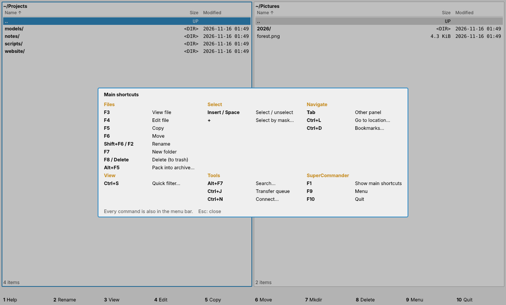

| Files | |
|---|---|
| F3 | View file |
| F4 | Edit file |
| F5 | Copy |
| F6 | Move |
| Shift+F6, F2 | Rename |
| Ctrl+M | Multi-rename |
| F7 | New folder |
| F8, Delete | Delete (to trash) |
| Shift+F8, Shift+Delete | Delete permanently |
| Alt+F5 | Pack into archive |
| Alt+F9 | Unpack archive |
| Alt+Enter | Properties and permissions |
| Ctrl+K | Checksum |

| Select | |
|---|---|
| Insert, Space | Select / unselect |
| + | Select by mask |
| - | Unselect by mask |
| * | Invert selection |
| Ctrl+A | Select all |

| Navigate | |
|---|---|
| Enter | Open / enter |
| Backspace | Parent folder |
| Tab | Other panel |
| Ctrl+L | Go to location |
| Alt+Left, Alt+Right | Back, forward |
| Alt+F1, Ctrl+N | Drives and connections |
| Ctrl+D | Bookmarks |
| Ctrl+Shift+D | Bookmark this folder |
| Ctrl+T, Ctrl+W | New tab, close tab |
| Ctrl+Tab, Ctrl+PageDown | Next tab |
| Ctrl+Shift+Tab, Ctrl+PageUp | Previous tab |
| Alt+O | Open this folder in the other panel |
| Ctrl+U | Swap panels |

| View | |
|---|---|
| Ctrl+R | Refresh |
| Ctrl+H | Show hidden files |
| Ctrl+S | Quick filter |
| Ctrl+F3, Ctrl+F4, Ctrl+F6, Ctrl+F5 | Sort by name, extension, size, date |
| Ctrl+Q | Quick view in the other panel |

| Tools | |
|---|---|
| Alt+F7 | Search |
| Alt+C | Compare files or folders |
| Ctrl+J | Transfer queue |
| Alt+X | Plugins and scripts |

| SuperCommander | |
|---|---|
| F1 | Show main shortcuts |
| F9 | Commands: find and run any command, give it a shortcut |
| Ctrl+, | Settings (options and shortcuts) |
| F10 | Quit |

Every command, with all its shortcuts, is in the [command list (F9)](#commands-f9).
